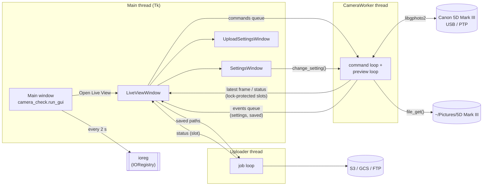
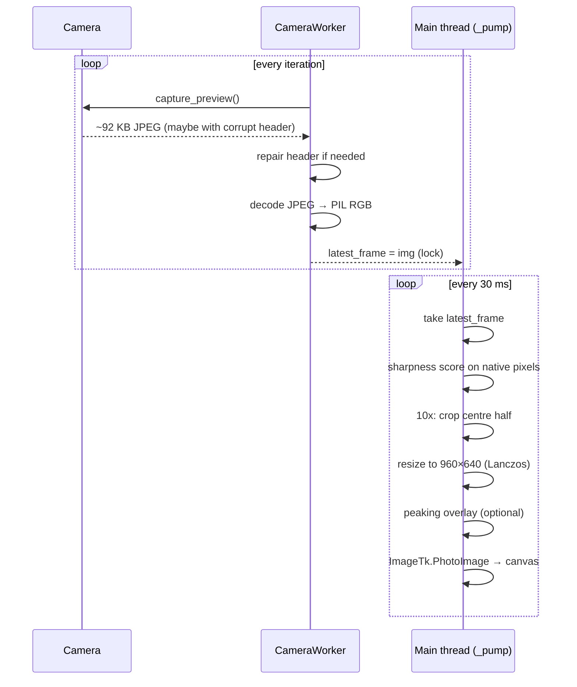

# 5D Mark III Checker — Technical Documentation

This document describes how the app works internally: its architecture, threading model, how it talks to the Canon EOS 5D Mark III, the camera quirks it works around, the focus-peaking and sharpness algorithms, the upload subsystem, and how it was tested. It is written for developers who want to understand, maintain or extend the code.

For installation and everyday use, see the [README](../README.md).

---

## Contents

1. [Overview](#1-overview)
2. [Requirements and dependencies](#2-requirements-and-dependencies)
3. [Repository layout](#3-repository-layout)
4. [Architecture](#4-architecture)
5. [Threading model](#5-threading-model)
6. [Camera detection (`camera_check.py`)](#6-camera-detection-camera_checkpy)
7. [Talking to the camera (libgphoto2 / PTP)](#7-talking-to-the-camera-libgphoto2--ptp)
8. [Live view pipeline](#8-live-view-pipeline)
9. [Coordinate systems: AF frame, zoom and clicks](#9-coordinate-systems-af-frame-zoom-and-clicks)
10. [Autofocus and manual focus](#10-autofocus-and-manual-focus)
11. [Zoom](#11-zoom)
12. [Focus peaking and the sharpness score (`peaking.py`)](#12-focus-peaking-and-the-sharpness-score-peakingpy)
13. [Photo capture](#13-photo-capture)
14. [Exposure settings](#14-exposure-settings)
15. [Uploads (`uploads.py`)](#15-uploads-uploadspy)
16. [User interface reference](#16-user-interface-reference)
17. [Error handling and recovery](#17-error-handling-and-recovery)
18. [Security considerations](#18-security-considerations)
19. [Performance](#19-performance)
20. [Testing](#20-testing)
21. [Known limitations](#21-known-limitations)
22. [Troubleshooting](#22-troubleshooting)
23. [Extending the app](#23-extending-the-app)
24. [Appendix A: Camera behaviour measured during development](#appendix-a-camera-behaviour-measured-during-development)
25. [Appendix B: gphoto2 configuration keys used](#appendix-b-gphoto2-configuration-keys-used)

---

## 1. Overview

The app is a tethered-shooting tool for a Canon EOS 5D Mark III connected to a Mac over USB. It is written in Python with a Tkinter GUI and uses [libgphoto2](http://www.gphoto.org/) (through the [`gphoto2`](https://github.com/jim-easterbrook/python-gphoto2) Python bindings) to speak PTP (Picture Transfer Protocol) with Canon's EOS extensions.

Features:

| Feature | Implemented in | Mechanism |
|---|---|---|
| Connection check (GUI, `--cli`, `--watch`) | `camera_check.py` | macOS IORegistry via `ioreg` |
| Live view (~14–22 fps) | `liveview.py` `CameraWorker` | `capture_preview()` + JPEG header repair |
| Click-to-focus | `liveview.py` | `eoszoomposition` + `autofocusdrive` |
| Zoom 1x / 5x / 10x | `liveview.py` | `eoszoom` (5x) + software crop (10x) |
| Manual focus steps + hotkeys | `liveview.py` | `manualfocusdrive` |
| Focus peaking + sharpness score | `peaking.py` | NumPy gradient magnitude |
| Photo capture | `liveview.py` | `capture(GP_CAPTURE_IMAGE)` + `file_get()` |
| ISO / aperture / shutter speed | `liveview.py` `SettingsWindow` | `iso`, `aperture`, `shutterspeed` config |
| Upload to S3 / GCS / FTP(S) | `uploads.py` | boto3, google-cloud-storage, ftplib |

The app is **macOS only** (it relies on `ioreg`, the macOS Keychain, `open`, and macOS's `ptpcamerad`).

---

## 2. Requirements and dependencies

### System

| Component | Version tested | Notes |
|---|---|---|
| macOS | Darwin 27.x on Apple silicon (Mac mini) | |
| Python | 3.15 (python.org framework build) | Tkinter with Tk 9.0 |
| libgphoto2 | 2.5.34 (Homebrew) | Required to build the `gphoto2` Python package |
| pkgconf | 3.0.x (Homebrew) | Build-time only |

There were no prebuilt `gphoto2` wheels for Python 3.15, so the package is compiled against Homebrew's libgphoto2. That is why `brew install libgphoto2 pkgconf` is part of setup.

### Python packages (`requirements.txt`)

| Package | Used for |
|---|---|
| `gphoto2` | Camera control (PTP) |
| `pillow` | JPEG decoding, resizing, Tk images |
| `numpy` | Focus peaking and sharpness maths |
| `boto3` | Amazon S3 uploads |
| `google-cloud-storage` | Google Cloud Storage uploads |
| `keyring` | Storing secrets in the macOS Keychain |
| `certifi` | CA bundle for FTPS certificate verification |

`camera_check.py --cli` and `--watch` use only the standard library and run with any Python 3. Heavy modules are imported lazily: `liveview` is imported only when **Open Live View** is pressed, and `boto3` / `google.cloud.storage` only when an upload or connection test actually runs.

---

## 3. Repository layout

```
.
├── camera_check.py          Main window + USB detection (stdlib only)
├── liveview.py              Live view window, CameraWorker thread, SettingsWindow
├── peaking.py               Focus peaking overlay and sharpness score
├── uploads.py               S3 / GCS / FTP upload code, Uploader thread, settings window
├── Start Camera App.command Double-clickable launcher (runs .venv/bin/python camera_check.py)
├── requirements.txt         Pinned Python dependencies
├── README.md                User-facing overview
└── docs/TECHNICAL.md        This document
```

Files created at runtime, outside the repository:

| Path | Contents |
|---|---|
| `~/Pictures/5D Mark III/` | Captured photos (`IMG_YYYYMMDD_HHMMSS.CR2`, etc.) |
| `~/Library/Application Support/5D Mark III Checker/uploads.json` | Upload settings (no secrets) |
| macOS Keychain, service `5D Mark III Checker` | `s3_secret_access_key`, `ftp_password` |

---

## 4. Architecture



Key design rules:

- **One owner per resource.** Only the `CameraWorker` thread touches the camera, so libgphoto2 is never called concurrently. Only the main thread touches Tk widgets.
- **The UI never blocks on the camera.** Camera operations take from tens of milliseconds (a preview frame) to several seconds (autofocus, capture), so they all run on the worker thread.
- **Frames are dropped, not queued.** The worker publishes only the *latest* frame. If the UI falls behind, stale frames are discarded instead of building latency.

---

## 5. Threading model

| Thread | Created by | Lifetime | Responsibilities |
|---|---|---|---|
| Main (Tk) | Python | App lifetime | All widgets, event handling, `_pump()` every 30 ms, peaking/score computation, image display |
| `CameraWorker` | `LiveViewWindow.__init__` | While the live view window is open | Opening the camera, all gphoto2 calls, preview loop, executing commands |
| `Uploader` | `LiveViewWindow.__init__` | Daemon, app lifetime | Uploading saved files to enabled destinations, one job at a time |
| Connection-test threads | `UploadSettingsWindow._test` | One per click | Running `test_s3` / `test_gcs` / `test_ftp` |

### UI → worker: command queue

`CameraWorker.commands` is a `queue.Queue` of tuples. Public methods on the worker (called from the UI thread) only enqueue:

| Method | Command tuple | Handler |
|---|---|---|
| `focus_at(fx, fy)` | `("focus", fx, fy)` | `_focus` |
| `set_zoom(level, fx, fy)` | `("zoom", level, fx, fy)` | `_zoom` |
| `nudge_focus(step)` | `("nudge", step)` | `_nudge` |
| `take_photo()` | `("capture",)` | `_capture` |
| `request_settings()` | `("get_settings",)` | `_read_settings` |
| `change_setting(name, value)` | `("set_setting", name, value)` | `_change_setting` |

The worker's main loop (`CameraWorker.run`):

```
open camera (with ptpcamerad race handling)
while not stopped:
    drain the command queue, executing each command in order
    if an autofocus has been running for AF_SECONDS: release it
    grab one preview frame (repair + decode + publish)
    on gphoto2 error: count it; give up after 20 consecutive errors
finally:
    release AF, reset zoom to 1x, turn the viewfinder off, camera.exit()
```

Commands are executed between preview frames, so a command waits at most for one frame grab (about 50 ms).

### Worker → UI: slots and an event queue

The worker never calls Tk. It reports through three callbacks given to its constructor:

| Callback | Implementation in `LiveViewWindow` | Semantics |
|---|---|---|
| `on_frame(img)` | stores into `latest_frame` under `self.lock` | Last value wins; older frames are dropped |
| `on_status(text)` | stores into `latest_status` under `self.lock` | Last value wins |
| `on_event(evt)` | `self.events.put` | Every event is delivered (`("settings", info)`, `("saved", [paths])`) |

The `Uploader` reports through `latest_upload_status` in the same way.

`LiveViewWindow._pump()` runs on the main thread every 30 ms via `win.after`. It takes the slots, processes the frame (score, crop, resize, peaking), updates labels and drains the event queue. It stops rescheduling after `close()` or when the worker thread has exited.

### Key-repeat throttling

Holding `;` generates key repeats faster than the lens can move (each `_nudge` takes roughly 100–200 ms). `nudge_focus` keeps a `pending_nudges` counter under `nudge_lock`, and drops new requests while 2 are already queued. In testing, a burst of 10 key events produced exactly 2 lens movements, so focus stops almost as soon as the key is released.

### Shutdown

`LiveViewWindow.close()` sets `closed` (which stops `_pump`), destroys the settings window, calls `worker.stop()` and `worker.join(timeout=3)`, then destroys the window. The worker's `finally` block releases AF, resets zoom, turns live view off on the camera and closes the PTP session, so the camera is left in a normal state.

---

## 6. Camera detection (`camera_check.py`)

Detection does not use libgphoto2. It reads the macOS IORegistry, which is fast, has no side effects, and works even while another process holds the camera.

```
ioreg -a -p IOUSB -l
```

- `-p IOUSB` limits output to the USB plane, `-l` includes properties, and `-a` emits an XML property list.
- `usb_devices()` parses it with `plistlib` and walks `IORegistryEntryChildren` iteratively, yielding each node that has an `idVendor`.

Matching:

| Field | Value | Meaning |
|---|---|---|
| `idVendor` | `0x04A9` | Canon Inc. |
| `idProduct` | `0x323A` | EOS 5D Mark III |

`check_camera()` returns one of:

| Status | Condition | Main window |
|---|---|---|
| `connected` | VID and PID match | Green dot; **Open Live View** enabled |
| `other_canon` | Canon VID, different PID | Orange dot |
| `missing` | No Canon device | Red dot |

The camera reports its USB product string as the generic **"Canon Digital Camera"**, not "5D Mark III", so matching uses the IDs, never the name.

A powered-off or sleeping camera disappears from the USB bus completely. With the default **Auto power off: 1 min**, the `--watch` log shows the camera dropping off about 60 seconds after it was last used.

Modes:

| Invocation | Behaviour | Exit code |
|---|---|---|
| `camera_check.py` | Tk main window, polls every `POLL_SECONDS` (2 s) | 0 |
| `camera_check.py --cli` | Prints status once | 0 if connected, 1 otherwise |
| `camera_check.py --watch` | Prints a timestamped line on every status change | 0 on Ctrl+C |

---

## 7. Talking to the camera (libgphoto2 / PTP)

### Opening the camera and the `ptpcamerad` race

macOS runs `/usr/libexec/ptpcamerad`, which claims PTP cameras as soon as they appear (for Photos and Image Capture). While it holds the USB interface, libgphoto2 fails with `GP_ERROR_IO_USB_CLAIM` (-53). Stopping it is not enough, because launchd restarts it almost immediately. During development, consecutive attempts went:

```
attempt 1  -53  Could not claim the USB device   (ptpcamerad holds it) → killall ptpcamerad
attempt 2  -105 Unknown model                     (device re-enumerating)
attempt 3  -53  Could not claim the USB device   (ptpcamerad relaunched and won)
attempt 4  -105 Unknown model
attempt 5  connected
```

`CameraWorker._open_camera()` therefore loops for up to **12 seconds**:

- On `-53` / `GP_ERROR_IO_LOCK` / `GP_ERROR_IO`: run `killall -9 ptpcamerad`, then retry.
- On `-105` (`GP_ERROR_MODEL_NOT_FOUND`): give up immediately only if `camera_check.check_camera()` says the camera really is not on USB. Otherwise it is mid re-enumeration, so retry.
- Wait 0.7 s between attempts, short enough to win the race against the relaunch.

Once libgphoto2 holds the interface, `ptpcamerad` cannot take it back until the session ends.

### Setting configuration values: `_set()`

All camera controls go through gphoto2's configuration tree, using `get_single_config(name)` / `set_single_config(name, widget)`. Single-config access avoids downloading the whole tree, which is slow.

While the camera is busy (focusing, moving the AF frame, switching zoom), it answers `GP_ERROR_CAMERA_BUSY` (-110, "I/O in progress"). `_set()` retries up to 40 times, **grabbing a preview frame between attempts**. That keeps live view flowing and gives the camera time to finish. If it is still busy after that, `_set()` raises `RuntimeError`.

---

## 8. Live view pipeline



### Frame sizes

| Camera zoom | JPEG size from the camera | Content |
|---|---|---|
| 1x | 960 × 640 | Whole frame, downscaled (sensor is 5760 × 3840) |
| 5x (and camera "10x") | 1152 × 768 | 1/5 × 1/5 of the sensor at **native resolution** (1:1 sensor pixels) |

`magnified = (img.size == (1152, 768))` is how the UI tells a magnified frame from a 1x frame. This matters while zoom is switching, when frames of the old size can still arrive.

The canvas is a fixed **960 × 640** (`DISPLAY_W`, `DISPLAY_H`). Every frame is resized to that size, so the window never changes size when zooming.

### JPEG header corruption and repair

This is the most important camera quirk the app handles.

The 5D Mark III, through libgphoto2 2.5.34, sends many live view frames whose **first 32 bytes are overwritten** with what appears to be a Canon EVF data record, instead of the JPEG header:

```
good frame:  ff d8 ff db 00 84 00 03 02 02 03 02 02 03 03 02 03 03 03 03 04 04 07 04 ...
bad frame:   01 00 00 00 00 00 00 00 40 af dc 03 01 00 00 00 ff 3e 01 00 00 00 00 00 ...
                                                                      ^ identical from byte 32 on
```

- **At 1x**, every other frame is corrupted (they strictly alternate).
- **When magnified**, almost every frame is corrupted: in one 4-second sample, 108 of 113 frames were bad.

Discarding bad frames halved the frame rate at 1x and **froze live view entirely when zoomed** (the original "zoom doesn't work" bug). The bytes from offset 32 onwards are intact, and the first 32 bytes of a good frame are constant: the SOI marker, the DQT marker and the start of the quantisation table, which does not change between frames. So `_grab_frame()` repairs them:

```python
if data[:2] == b"\xff\xd8":              # good frame: remember its header
    self.jpeg_header = data[:32]
elif self.jpeg_header is not None:        # bad frame: splice the header back
    data = self.jpeg_header + data[32:]
else:
    return                                # no good frame seen yet
```

A 1x header also repairs magnified frames correctly. Repaired frames were checked visually and decode fully, with no failures. If a repaired frame still fails to decode, it is skipped (`OSError` is caught).

### Display processing in `_pump()`

1. **Score:** `_update_score(img, magnified)` runs on the frame *before* any resizing (see §12).
2. **10x crop:** if the UI zoom is 10 and the frame is magnified, crop to the centre half: `(w/4, h/4, 3w/4, 3h/4)`, which is 576 × 384 native pixels.
3. **Resize:** to 960 × 640 with Lanczos resampling. That is a slight downscale at 5x (1152 → 960) and a ~1.67x upscale at 10x (576 → 960).
4. **Peaking:** if enabled, `peaking.overlay(img, sensitivity, scale)`, with `scale = 0.6` at 10x to compensate for edges softened by upscaling.
5. **Display:** convert to `ImageTk.PhotoImage`, keep a reference in `self.photo` (otherwise Tk shows nothing), raise the AF marker above the image.

---

## 9. Coordinate systems: AF frame, zoom and clicks

Three coordinate systems are involved:

| System | Range | Used for |
|---|---|---|
| Camera EVF coordinates | x ∈ [0, 5760), y ∈ [0, 3840) | `eoszoomposition` |
| Normalised frame coordinates | fx, fy ∈ [0, 1] of the **full** frame | `focus_point`, all internal state |
| View coordinates | vx, vy ∈ [0, 1] of the **displayed** image | mouse clicks |

### Camera coordinates

`eoszoomposition` takes `"x,y"`: the **top-left corner** of the magnification box in sensor-pixel coordinates (5760 × 3840 for the 5D Mark III). The box is 1/5 of the sensor in each dimension: 1152 × 768 (`ZOOM_BOX_W`, `ZOOM_BOX_H`). In FlexiZone-Single AF, the AF frame follows this box, so the same command positions both the AF point and the zoom area.

This was confirmed on the camera by setting the position to `0,0` and to `4608,3072` and zooming to 5x: the views showed the top-left and bottom-right corners of the scene respectively.

### Conversions

Centre a box on (fx, fy), clamped so it stays on the sensor (`frame_top_left`):

```
x = clamp(fx·5760 − 1152/2, 0, 5760 − 1152)
y = clamp(fy·3840 −  768/2, 0, 3840 −  768)
```

The centre where the camera actually puts the box, after clamping (`frame_center`):

```
cx = (x + 576) / 5760
cy = (y + 384) / 3840
```

`frame_center` is used for drawing the green AF box and for click mapping. Near the edges, the box cannot centre on the exact click point.

### Click mapping (`LiveViewWindow.on_click`)

At **1x** the view shows the whole frame, so `(fx, fy) = (vx, vy)`.

When **magnified** (zoom Z = 5 or 10), the view shows a 1/Z × 1/Z window centred on the current frame centre (cx, cy):

```
fx = clamp(cx + (vx − 0.5) / Z, 0, 1)
fy = clamp(cy + (vy − 0.5) / Z, 0, 1)
```

This holds for 10x as well, because the software crop is centred on the same point. After a click, the new `focus_point` is sent to the camera (`_move_frame` + autofocus). The camera re-centres the magnified view on it, so clicking while zoomed also pans the view.

### The AF marker

- At 1x: a rectangle 1/5 of the view (192 × 128 px) centred on `frame_center(focus_point)`. This matches the camera's AF/magnify box.
- When magnified: a fixed 40 × 40 px box at the view centre, since the AF frame is always the view centre.

---

## 10. Autofocus and manual focus

### Autofocus: `_focus(fx, fy)`

1. `_release_af()`: end any autofocus still running.
2. `_move_frame(fx, fy)`: set `eoszoomposition`, then grab one frame so the camera can move the frame before focusing.
3. `_set("autofocusdrive", 1)`: libgphoto2 sends Canon's "do AF" operation.
4. Set `af_release_at = now + AF_SECONDS` (2.0 s).
5. The main loop keeps streaming frames. When the deadline passes, `_release_af()` sets `autofocusdrive` to 0 and the status becomes "Focus done".

**Why wait before releasing?** Setting `autofocusdrive` to 0 *cancels* autofocus. The first implementation released it immediately, and the lens never moved. Until the release happens, the camera also answers further configuration changes with "I/O in progress". So every operation that changes camera state (`_zoom`, `_nudge`, `_capture`, a new `_focus`) calls `_release_af()` first.

Live view autofocus on this body is **contrast-detect** (the 5D Mark III has no on-sensor phase detection). Consequences seen in testing:

- In dim light, if the AF box contains both a dark subject and high-contrast background edges (a tripod against a door), AF can lock on the background.
- AF can settle slightly short of peak sharpness. In one test, the score peaked at 92.8 during the AF sweep but settled at 73.5. The sharpness score and the manual focus steps exist to correct this.

The camera's live view AF method must be **FlexiZone – Single** (gphoto2 `afmethod` = `Live`). In `LiveFace` (Face+Tracking) the camera chooses the point itself.

### Manual focus steps: `_nudge(step)`

`manualfocusdrive` accepts `Near 1`, `Near 2`, `Near 3`, `Far 1`, `Far 2`, `Far 3` and `None`. The app sets the step, grabs one frame, then sets `None`.

| UI | Key | Step | Measured effect (EF 35mm f/1.4L, 5x, sharpness score) |
|---|---|---|---|
| `<` / `>` | `;` / `'` | `Near 1` / `Far 1` | Very fine: score moved ~0.1–0.5 per step |
| `<<` / `>>` | `Cmd`+`;` / `Cmd`+`'` | `Near 2` / `Far 2` | Clearly visible at 5x |
| `<<<` / `>>>` | `Ctrl`+`;` / `Ctrl`+`'` | `Near 3` / `Far 3` | Large: 15.0 → 5.8 in one step |

Focus drive uses the lens motor, so **the lens switch must be on AF**, even for "manual" steps. The step size in focus distance depends on the lens.

---

## 11. Zoom

The camera's `eoszoom` accepts `1`, `5` and `10`. Over USB, though, **the camera's 10x live view stream is identical to its 5x stream**: the same 1152 × 768 crop. That was confirmed by comparing frames from both. (On the camera's rear LCD, 10x does magnify further.)

The app therefore:

| UI zoom | Camera `eoszoom` | Display |
|---|---|---|
| 1x | `1` | Full frame |
| 5x | `5` | 1152 × 768 native crop → 960 × 640 |
| 10x | `5` | Centre 576 × 384 of the native crop → 960 × 640 |

Since 5x is already 1:1 sensor pixels, the software 10x is a true 2x enlargement of real detail. It shows exactly what the camera's 10x would.

`_zoom(level, fx, fy)` releases AF, moves the frame to the focus point (for 5x and 10x), sets `eoszoom`, and stores `zoom_state` so zoom can be restored after a capture. Before this was implemented, zoom always magnified the top-left corner, because the camera's frame position starts at `0,0`.

---

## 12. Focus peaking and the sharpness score (`peaking.py`)

### Edge strength

Both features share one edge measure, `edge_strength(g)`, computed on an 8-bit greyscale image as float32:

1. **3 × 3 box blur** (`_blur`), built from nine shifted views of an edge-padded array. This suppresses JPEG block noise and sensor noise, which would otherwise look like fine detail, especially at high ISO.
2. **Central differences:**
   `gx = b[y, x+1] − b[y, x−1]`, `gy = b[y+1, x] − b[y−1, x]`
3. **Magnitude:** `|gx| + |gy|` (L1 norm, cheaper than √(gx² + gy²) and good enough here). The one-pixel border is zero.

### Peaking overlay

```python
mask = edge_strength(gray) > SENSITIVITY[level] * threshold_scale
rgb[mask] = (255, 40, 40)
```

| Sensitivity | Threshold | Share of pixels marked (sample 1x frames) |
|---|---|---|
| Low | 70 | 0.2–0.6 % |
| Medium (default) | 45 | 1.2–2.4 % |
| High | 28 | 3.3–7.9 % |

The thresholds were chosen from the edge-strength distribution of real live view frames (the 97th–99.7th percentiles fell between roughly 30 and 84). With them, only the in-focus plane is outlined, even with an f/1.4 lens. The overlay runs on the **displayed** 960 × 640 image. At 10x that image is upscaled and edges are softer, so the threshold is multiplied by 0.6.

### Sharpness score

`sharpness(img, box)` is a **Tenengrad**-style focus measure, the mean squared gradient magnitude inside a region:

```
score = mean(edge_strength(region)²) / 10
```

Squaring weights strong, crisp edges much more than broad gradients, so the score peaks sharply at best focus. The `/10` just keeps the numbers readable.

The **region** and **pixels** are chosen for precision (`LiveViewWindow._update_score`):

| View | Pixels scored | Region |
|---|---|---|
| 1x | 960 × 640 downscaled frame | The AF box: 1/5 of the frame around `frame_center(focus_point)` |
| 5x / 10x | 1152 × 768 **native** frame (before display scaling) | Centre half, 576 × 384, exactly what 10x displays |

Magnified scoring uses native sensor pixels and the same region at 5x and 10x. So 5x and 10x give **identical scores**, much more sensitive than 1x. 1x and magnified scores are on different scales, so "best" resets when switching between them (but not between 5x and 10x).

### Smoothing, "best" and the bar

- **Smoothing:** exponential moving average, `avg = 0.6·avg + 0.4·score`.
- **Best:** the running maximum of `avg` since the last reset.
- **Ratio:** `avg / best` sets the bar fill (140 px wide) and colour: green ≥ 97 %, orange ≥ 85 %, red below.
- **Reset** on: clicking a new focus point, switching between 1x and magnified, toggling peaking, or pressing **Reset best**.

### Protection against false "best" values

While the camera switches zoom or moves the AF frame, it emits a few garbled frames. Their high-frequency garbage once produced a "best" of 71 when the real peak was about 31. Two guards prevent this:

1. **Settle period:** for 1.0 s after a reset (`score_settle_until`), scores are ignored and the label shows "Sharpness settling...".
2. **Spike rejection:** a frame whose raw score is more than `3·avg + 5` is ignored.

### Recommended workflow

1. Click the subject (AF moves the focus frame there).
2. Zoom to 5x or 10x.
3. Step with `;` / `'` and watch the score. When the score starts to fall, step back once. A full green bar means you are within 3 % of the best focus seen.

---

## 13. Photo capture

`_capture()`, triggered by **Take Photo** or the space bar:

1. `_release_af()`.
2. `camera.capture(GP_CAPTURE_IMAGE)`. libgphoto2 performs a remote shutter release during live view and returns a `CameraFilePath`. Measured: about **2.0 s** from the call to the file being available.
3. For 1.5 s, poll `wait_for_event(100)` and collect any `GP_EVENT_FILE_ADDED` events. With RAW + JPEG the camera reports the second file this way. `GP_EVENT_CAPTURE_COMPLETE` (4) is also seen.
4. For each file: `file_get(folder, name, GP_FILE_TYPE_NORMAL).save(dest)`.
5. Publish `("saved", [paths])`, which the UI forwards to the Uploader.
6. Live view restarts unmagnified after a shot, so if `zoom_state` is 5x or 10x, `_zoom()` is called again.

**File naming:** the camera names every file `capt0000.<ext>`, so files are renamed to `IMG_<YYYYMMDD>_<HHMMSS><EXT>` in `~/Pictures/5D Mark III/`. If two shots land in the same second, a `_2`, `_3`, … suffix is added. The extension comes from the camera's file name, upper-cased (`.CR2`, `.JPG`).

**Capture target:** gphoto2's `capturetarget` was left at its default, **Internal RAM**. Images are transferred to the Mac and **not written to the memory card**.

**Image format** follows the camera's own setting (`imageformat`, e.g. `RAW`, `RAW + L`, `L`). A full-size CR2 is about 27 MB.

A capture blocks the worker thread, so live view pauses for about 2–3.5 s (capture plus the event window plus the download).

---

## 14. Exposure settings

`SettingsWindow` shows the mode and three settings:

| gphoto2 key | Label | Example choices on the 5D Mark III |
|---|---|---|
| `autoexposuremode` | Mode dial | `P`, `TV`, `AV`, `Manual`, `Bulb`, `Custom`, ... (read only in practice) |
| `iso` | ISO | `Auto`, `100` … `25600`, `51200`, `102400` (28 values) |
| `aperture` | Aperture (f/) | Depends on the lens; EF 35mm f/1.4L: `1.4` … `22` (25 values) |
| `shutterspeed` | Shutter speed | Mode dependent; in Av it is just `auto` |

Flow:

1. Opening the window calls `request_settings()`. `_read_settings()` reads the mode and each setting's value and choices, and emits `("settings", info)`.
2. `SettingsWindow.show(info)` fills read-only comboboxes. A setting with ≤ 1 choice is disabled and marked "set automatically in this mode".
3. Choosing a value calls `change_setting(name, value)`. `_change_setting()` uses `_set()`, reports the result, then re-reads all settings, so the window always shows the camera's real state (e.g. if the camera rounded a value).

The 5D Mark III's **mode dial is physical** and cannot be changed remotely. It decides what is settable: **M** for all three, **Av** for aperture (shutter automatic), **Tv** for shutter speed (aperture automatic). ISO is settable in every creative mode. After turning the dial, press **Refresh**.

---

## 15. Uploads (`uploads.py`)

### Configuration

`uploads.json` (in `~/Library/Application Support/5D Mark III Checker/`) has this structure. These are the defaults from `DEFAULTS`:

```json
{
  "s3":  {"enabled": false, "bucket": "", "prefix": "", "region": "",
          "access_key_id": "", "endpoint_url": ""},
  "gcs": {"enabled": false, "bucket": "", "prefix": "", "credentials_file": ""},
  "ftp": {"enabled": false, "host": "", "port": 21, "username": "",
          "remote_dir": "", "tls": true}
}
```

`load_config()` deep-copies `DEFAULTS` and overlays the saved file, so new keys added in future versions get default values. The file contains **no secrets**.

Secrets are stored in the macOS Keychain through `keyring`, under service `5D Mark III Checker`:

| Account | Secret |
|---|---|
| `s3_secret_access_key` | AWS secret access key |
| `ftp_password` | FTP password |

Saving an empty secret field deletes the Keychain entry.

### Remote object names

`_remote_name(prefix, path)` gives `prefix/filename`, with slashes trimmed from the prefix, or just `filename` if there is no prefix. For example, prefix `5d/` and `IMG_20261116_181052.CR2` give `5d/IMG_20261116_181052.CR2`.

### Amazon S3

- `boto3.client("s3", region_name=?, endpoint_url=?, aws_access_key_id=?, aws_secret_access_key=?)`. Only non-empty options are passed.
- If **Access key ID** is empty, boto3 uses its default credential chain: environment variables, `~/.aws/credentials` / `~/.aws/config` (as set up by `aws configure`), SSO, and so on.
- **Endpoint URL** allows S3-compatible services (MinIO, Wasabi, Cloudflare R2, Backblaze B2 S3 API).
- Upload: `upload_file(path, bucket, key)`, which automatically switches to multipart upload for large files.
- Test: `head_bucket(Bucket=...)`.
- Minimum IAM permissions: `s3:PutObject` on `arn:aws:s3:::BUCKET/PREFIX*` to upload; `s3:ListBucket` on the bucket for **Test connection**.

### Google Cloud Storage

- With a **service account key file**: `storage.Client.from_service_account_json(path)`. Otherwise `storage.Client()`, which uses Application Default Credentials (`gcloud auth application-default login`).
- Upload: `bucket.blob(key).upload_from_filename(path)` (resumable for large files).
- Test: `list(bucket.list_blobs(max_results=1))`.
- Minimum roles: **Storage Object Creator** to upload; **Storage Object Viewer** for the connection test.

### FTP / FTPS

- `tls: true` (default) gives **explicit FTPS**: `ftplib.FTP_TLS` with `ssl.create_default_context(cafile=certifi.where())`.
  - Python's `ftplib` does **not** verify certificates by default. The explicit context makes it verify the certificate chain and host name against certifi's CA bundle.
  - `prot_p()` is called after login, so the **data channel** (the file itself) is encrypted, not only the login.
- `tls: false` gives plain FTP. The settings window warns that the password is sent unencrypted.
- Connect timeout: 30 s. Login uses `username` (default `anonymous`) and the Keychain password.
- `_ftp_cd(remote_dir, create)`: a leading `/` starts from the root, then each path component is entered with `CWD`. For uploads (`create=True`), missing directories are created with `MKD`. The connection test (`create=False`) reports a missing folder as an error instead of creating it.
- Upload: `STOR <filename>` in binary mode. An existing file of the same name on the server is overwritten (server-dependent).

### The `Uploader` thread

```mermaid
sequenceDiagram
    participant W as CameraWorker
    participant UI as Main thread
    participant U as Uploader thread
    participant D as Destinations
    W-->>UI: event ("saved", [paths])
    UI->>U: upload(paths)   (only if any destination is enabled)
    U->>U: load_config()     (fresh, picks up recent changes)
    loop each enabled destination (S3, GCS, FTP)
        U->>U: check_required (bucket/host present?)
        U-->>UI: "Uploading to …"
        U->>D: upload each file
        D-->>U: OK / exception
    end
    U-->>UI: "Upload of IMG_…: Amazon S3 OK; Google Cloud Storage OK; FTP failed (…)"
```

- Jobs are processed one at a time, in order. Destinations are uploaded sequentially: S3, then GCS, then FTP.
- A failure at one destination doesn't stop the others. Each gets its own result in the summary.
- Errors are shortened to 160 characters (`short_error`).
- There is **no automatic retry** and no persistent queue. A failed upload is reported, and the local file remains in `~/Pictures/5D Mark III`.
- The thread is a daemon. Uploads still in progress when the app quits are abandoned.

### `UploadSettingsWindow`

A `ttk.Notebook` with one tab per destination, each with an **enabled** checkbox, fields, a hint and **Test connection**. **Test connection** first saves the settings (so it tests exactly what will be used), then runs the test on a background thread. The result is passed back through a dict and polled with `after(100)`, never by calling Tk from the background thread.

---

## 16. User interface reference

### Main window (`camera_check.run_gui`)

| Element | Behaviour |
|---|---|
| Status dot | Green, orange or red (see §6), refreshed every 2 s |
| Open Live View | Enabled while the camera is connected (or a live view window is already open). Imports `liveview` lazily and shows a hint if packages are missing |

### Live view window

| Row | Controls |
|---|---|
| Canvas (960 × 640) | Live view; click to focus; green AF marker |
| Focus / Zoom | `<<<` `<<` `<` near / far `>` `>>` `>>>`; zoom `1x` `5x` `10x` (the active one is highlighted) |
| Actions | **Take Photo**, **ISO / Aperture / Shutter...**, **Upload Settings...**, **Open Photos Folder** |
| Peaking | **Focus peaking (P)** checkbox, **Sensitivity** (Low / Medium / High), **Sharpness** score, bar, **Reset best** |
| Status lines | Camera status; upload status (blue); key help |

### Keyboard shortcuts (live view window focused)

| Key | Action |
|---|---|
| `;` | Focus nearer, small step |
| `'` | Focus farther, small step |
| `Cmd` + `;` / `Cmd` + `'` | Medium step |
| `Ctrl` + `;` / `Ctrl` + `'` | Big step |
| `Space` | Take photo |
| `P` | Toggle focus peaking |

Bindings are on the live view `Toplevel`. Tk dispatches the most specific modifier binding, so `Cmd`+`;` doesn't also fire the plain `;` binding. The handlers return `"break"`.

---

## 17. Error handling and recovery

| Situation | Detection | Behaviour |
|---|---|---|
| `ptpcamerad` holds the camera | gphoto2 `-53` on `init()` | `killall -9 ptpcamerad`, retry (up to 12 s) |
| Camera re-enumerating | `-105` but present in IORegistry | Retry |
| Camera absent | `-105` and absent from IORegistry | "Camera not found. Is it switched on and plugged in?" |
| Camera busy | `-110` on a config write | Retry up to 40 times, grabbing frames in between |
| Corrupt preview frame | No JPEG SOI | Header repair; skip if decoding still fails |
| Transient preview errors | gphoto2 error in `capture_preview` | Wait 0.1 s, retry; after 20 in a row → "Lost connection to the camera" |
| AF / focus drive fails | gphoto2 error or `RuntimeError` | Status message suggesting the lens AF switch |
| Capture fails | gphoto2 error | Status message (often AF couldn't lock with the lens on AF); live view continues |
| Upload fails | Any exception | Reported per destination; local file kept |
| Unexpected worker exception | Caught in `run()` | Shown in the status line; `finally` cleans up the camera |

---

## 18. Security considerations

- **Secrets** (S3 secret key, FTP password) are stored in the macOS Keychain, never in the repository or in `uploads.json`. The password fields are masked.
- **FTPS** verifies server certificates (Python's `ftplib` does not by default) and encrypts the data channel (`PROT P`). Plain FTP is opt-in and labelled as unencrypted.
- **S3 / GCS** use HTTPS through their official SDKs, which verify certificates. Credentials can come from the standard SDK credential chains, so keys never need to be typed into the app.
- **`killall -9 ptpcamerad`** stops a macOS system service belonging to the current user. launchd restarts it automatically, and the only effect is that Photos / Image Capture can't use the camera while the app holds it. No administrator rights are needed.
- **No network access** happens unless a destination is enabled or **Test connection** is pressed.
- The repository contains no credentials. Upload settings and secrets live outside the project folder.

---

## 19. Performance

Measured on an Apple silicon Mac mini with the 5D Mark III over USB 2.0:

| Metric | Value |
|---|---|
| Raw `capture_preview()` rate | ~20 calls/s (~50 ms each), ~92 KB per frame |
| Displayed frame rate, 1x | ~14 fps |
| Displayed frame rate, 5x / 10x | ~22 fps |
| Peaking overlay (960 × 640) | ~3 ms per frame |
| Sharpness score (576 × 384 native region) | < 1 ms per frame |
| Capture + download (27 MB CR2) | ~2.0 s for the capture, live view back after ~2–3.5 s |
| Settings change round trip | ~0.1–0.7 s |
| Autofocus | ~1–2 s (released after a fixed 2.0 s) |
| Connection (including the `ptpcamerad` race) | typically 1–4 s |

The frame rate is limited by the camera / USB round trip, not by the processing. Header repair is what lifted the 1x display rate from about 5–10 fps to about 14 fps, and made magnified live view work at all.

---

## 20. Testing

There is no automated test suite in the repository yet. During development the app was verified as follows.

### On the real camera (EOS 5D Mark III + EF 35mm f/1.4L USM)

| Area | How it was verified |
|---|---|
| Detection | `--cli` and `--watch` with the camera on, off and auto-powered-off; device list cross-checked with `ioreg` |
| Live view and repair | Raw frame dumps showing alternating corrupt headers; repaired frames decoded and inspected visually at 1x and 5x |
| Coordinate system | `eoszoomposition` set to `0,0`, `4608,3072` and the centre, then 5x frames inspected |
| Click-to-focus | Simulated clicks on near and far subjects (tripod vs. blinds, ink-bottle label); before/after frames compared |
| Zoom | 1x / 5x / 10x display frames compared; 5x and 10x from the camera shown to be identical; click-while-zoomed panning |
| Focus steps and hotkeys | Each key sequence generated in the Tk window; status messages and sharpness changes recorded; key-burst throttling (10 events → 2 moves) |
| Peaking and score | Overlay checked on real frames; score timeline recorded across zoom changes and focus steps; false-best guard verified |
| Capture | Photos taken during live view at 1x and 5x; CR2 size and naming checked; zoom restored afterwards |
| Exposure | ISO 1250 → 400 → 1250 and aperture f/11 → f/8 → f/11 in Av mode; shutter speed correctly disabled |

### Uploads (against local emulators)

| Destination | Test server | Verified |
|---|---|---|
| S3 | `moto` server (S3 API emulator) | Missing bucket → error; `head_bucket`; upload of a 27 MB CR2 with a prefix; object size |
| GCS | `gcp-storage-emulator` | Connection test; upload with a prefix; blob size |
| FTP | `pyftpdlib` | Missing folder → error; upload creating nested folders; wrong password → `530` |
| FTPS | A minimal explicit-TLS FTP server built on Python's `ssl` module | Self-signed certificate **rejected**; with the certificate trusted: upload, folder creation, `PROT P` enforced by the server, wrong password → `530` |
| Uploader thread | All of the above enabled at once | Combined summary message; one destination failing doesn't stop the others |

Not yet tested against real AWS, Google Cloud or third-party FTP servers.

---

## 21. Known limitations

- **One camera model.** USB IDs, the 5760 × 3840 coordinate system and the 32-byte header repair are specific to the 5D Mark III (see §23 for porting).
- **10x is digital** (a crop of the native 5x stream), because the camera's 10x USB stream is the same as 5x.
- **Contrast-detect AF** can choose the background in low light or low-contrast scenes.
- **AF release is time-based** (2.0 s), not based on an AF-complete event. Very slow AF may be cut short, and fast AF still holds the camera for the full 2 s.
- **Live view pauses** during capture (about 2–3.5 s).
- **Capture target is Internal RAM:** photos are not saved to the memory card.
- **RAW + JPEG** relies on the second file arriving within 1.5 s.
- **Uploads** run one file at a time with no retry, no progress bar and no persistent queue. Remote files with the same name are overwritten.
- **Exposure:** the mode dial can't be changed remotely. Exposure compensation, white balance, drive mode and picture style aren't exposed in the UI, although the camera supports them through gphoto2.
- **Mac only**, and the main window's hint text mentions "Mac mini".
- **Python 3.15** has no prebuilt `gphoto2` wheels, so libgphoto2 must be installed from Homebrew for the package to build.

---

## 22. Troubleshooting

| Symptom | Likely cause | Fix |
|---|---|---|
| Red dot / "not detected" | Camera off, asleep or cable unplugged | Turn the camera on, half-press the shutter; set **Auto power off: Disable**; try another USB cable or port |
| Camera drops off after ~1 minute | Auto power off | Set **Auto power off: Disable** in the Setup menu |
| "Could not connect to the camera" | Another app holds it | Quit Photos, Image Capture, Lightroom tether or any other live view window, then reopen live view |
| Clicks don't change focus | Lens on MF, or AF method is Face+Tracking | Lens switch to **AF**; AF method **FlexiZone – Single** |
| AF focuses on the background | Contrast AF picks the strongest edges in the box | Click so the subject fills the box; add light; refine with `;` / `'` |
| Focus step buttons do nothing | Lens on MF | Lens switch to **AF** |
| Shutter speed greyed out | Mode dial on Av / P | Turn the dial to **M** or **Tv**, then **Refresh** |
| Aperture greyed out | Mode dial on Tv / P | Turn the dial to **M** or **Av**, then **Refresh** |
| "Could not take the photo" | AF couldn't lock (lens on AF, half-press AF enabled) | Focus first, or switch the lens to MF for capture |
| Sharpness shows "settling..." | Just after a zoom or focus-point change | Wait about 1 s |
| Upload "failed (AccessDenied)" (S3) | Missing IAM permission | Grant `s3:PutObject` (and `s3:ListBucket` for the test) |
| Upload "failed (403 …)" (GCS) | Missing role | Grant Storage Object Creator (and Viewer for the test) |
| FTPS "CERTIFICATE_VERIFY_FAILED" | Self-signed or expired server certificate | Fix the server certificate (recommended), or use plain FTP on trusted networks only |
| `pip install gphoto2` fails | libgphoto2 / pkgconf missing | `brew install libgphoto2 pkgconf`, then reinstall |
| "Live view needs the gphoto2 and Pillow packages" | App started with the system Python | Start it with `Start Camera App.command` or `.venv/bin/python camera_check.py` |

---

## 23. Extending the app

### Adding another camera setting to the UI

1. Find the gphoto2 key and its choices, for example:
   ```python
   w = camera.get_single_config("whitebalance")
   [w.get_choice(i) for i in range(w.count_choices())]
   ```
2. Add `("whitebalance", "White balance")` to `EXPOSURE_SETTINGS` in `liveview.py`. `SettingsWindow` builds a row for every entry automatically. Increase the `row=` indices of the hint and buttons below the settings.

Useful keys already available on this body: `exposurecompensation`, `whitebalance`, `drivemode`, `picturestyle`, `imageformat`, `capturetarget`.

### Saving to the memory card as well

Set `capturetarget` to `Memory card` before capturing (e.g. once after `_open_camera()`). The camera then writes to the card, and `file_get()` still downloads a copy.

### Supporting another Canon EOS body

1. **Detection:** add the body's USB product ID next to `EOS_5D_MK3_PRODUCT_ID` in `camera_check.py`.
2. **Coordinate system:** set `COORD_W`, `COORD_H` to the body's live view coordinate system (often the sensor's pixel dimensions). Verify by setting `eoszoomposition` to `0,0` and to `(W − W/5, H − H/5)` at 5x, and checking that the corners are shown.
3. **Magnified frame size:** check the magnified JPEG size, and update the `magnified` test (`img.size == (ZOOM_BOX_W, ZOOM_BOX_H)`) if it doesn't equal the 5x box size.
4. **Header corruption:** check whether the body sends corrupt headers at all, and whether 32 bytes is the right repair length. Compare a good and a bad frame byte by byte.
5. **10x:** check whether the body's 10x USB stream differs from 5x. If it does, `_zoom` can send `10` directly, and the crop in `_pump` should be skipped.

### Adding an upload destination

1. Write `upload_<name>(c, path)` and `test_<name>(c)` in `uploads.py`. Return a human-readable location or message, and raise on failure.
2. Register them in `UPLOADERS`, `TESTERS`, `LABELS` and `DEFAULTS`, and add any secret to `SECRETS`.
3. Add its fields to `UploadSettingsWindow.FIELDS` and `HINTS`. Add the tab key to the loop in `UploadSettingsWindow.__init__`.
4. Add required-field validation to `check_required()`.

### Ideas for further work

- Use the camera's AF-complete event or an AF-state property instead of the fixed `AF_SECONDS`.
- A retrying, persistent upload queue with progress.
- Saving to the card in addition to the Mac (a capture-target option).
- Histogram and exposure warnings computed from live view frames.
- Focus stacking: a sequence of `manualfocusdrive` steps, capturing at each.
- An automated test suite: unit tests for `peaking.py`, coordinate maths and `uploads.py` (with `moto` / emulators), plus a mock `gphoto2.Camera` for `CameraWorker`.

---

## Appendix A: Camera behaviour measured during development

| Property | Observed value |
|---|---|
| USB VID / PID | `0x04A9` / `0x323A` |
| USB product string | "Canon Digital Camera" |
| Live view JPEG, 1x | 960 × 640, ~92 KB |
| Live view JPEG, 5x and camera 10x | 1152 × 768 (native), identical content |
| EVF coordinate system | 5760 × 3840; `eoszoomposition` = top-left of a 1152 × 768 box |
| Corrupt frames | First 32 bytes replaced (starting `01 00 00 00 00 00 00 00`); alternate frames at 1x, ~95 % when magnified |
| `eoszoom` initial read value | `0` (reads back `0` regardless of the value set) |
| `afmethod` choices | `Live` (FlexiZone-Single), `LiveFace` (Face+Tracking), `Quick` |
| `autofocusdrive` | 1 = start AF; 0 = cancel AF |
| Busy error while focusing | `-110` (`GP_ERROR_CAMERA_BUSY`, "I/O in progress") |
| Capture | ~2.0 s; returned as `/capt0000.cr2`; RAW ≈ 27.6 MB; event 4 (capture complete) follows |
| `capturetarget` default | `Internal RAM` |
| `autopoweroff` | `60` (seconds) on the test camera |
| Connection race | Alternating `-53` / `-105` for ~2–4 attempts after `killall ptpcamerad` |

## Appendix B: gphoto2 configuration keys used

| Key | Type | Values used | Where |
|---|---|---|---|
| `eoszoomposition` | text | `"x,y"` in EVF coordinates | `_move_frame` |
| `eoszoom` | text | `"1"`, `"5"` | `_zoom`, cleanup |
| `autofocusdrive` | toggle | `1`, `0` | `_focus`, `_release_af` |
| `manualfocusdrive` | radio | `Near 1-3`, `Far 1-3`, `None` | `_nudge` |
| `viewfinder` | toggle | `0` (live view off) | cleanup |
| `autoexposuremode` | radio | read only | `_read_settings` |
| `iso` | radio | camera's list | settings |
| `aperture` | radio | camera's list | settings |
| `shutterspeed` | radio | camera's list | settings |

Live view starts implicitly with the first `capture_preview()` call.
